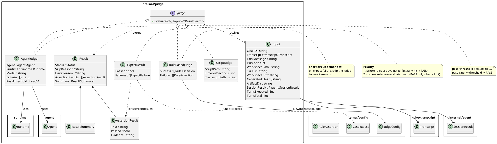

# judge — Evaluation Layer Core Package

`internal/judge` is the **evaluation layer** of the skill-up framework, responsible for grading Engine execution results.
All grading implementations share a unified `Judge` interface that takes an `Input` and returns a `*Result`.

## Feature Overview

| File | Responsibility |
|---|---|
| `judge.go` | Core interface (`Judge`) and shared data types (`Input`, `Result`, `AssertionResult`, `Status`); path safety validation (`safePath`); shared file-check helper (`fileExistsInWorkspace`) |
| `expect.go` | **Expect pre-check** — 7 lightweight checks; on failure short-circuits and skips the subsequent Judge to save tokens |
| `factory.go` | **Factory function** — creates concrete Judge instances from `JudgeConfig`; configuration merge logic |
| `rule_based.go` | **RuleBasedJudge** — declarative rule evaluation with failure-priority semantics |
| `script.go` | **ScriptJudge** — runs an external script (exit 0 = PASS), supports timeout control |
| `agent_judge.go` | **AgentJudge** — LLM-as-Judge; uses `agent.Agent` + `runtime.Runtime`; supports `pass_threshold` |

## Architecture and Module Relationships



## Evaluation Flow

```
Runner entry point
      │
      ▼
 ┌──────────────┐    failure → FAIL (short-circuit, judge not called)
 │   Expect     │──────────────────────────────────────▶ Result
 │ pre-check    │
 └──────┬───────┘
        │ pass
        ▼
 ┌──────────────┐
 │   Judge      │──▶ rule_based / script / agent_judge
 │  evaluation  │
 └──────┬───────┘
        │
        ▼
     Result (grading.json)
```

## Notes per Judge Type

### Single-judge scoring

The scoring denominator is configured before the expect gate: one assertion per
configured expect rule type, plus each agent-judge criterion, each rule-based
success/failure rule, or the script judge's single outcome. No judge adds zero
assertions. A failed expect gate returns a FAIL case and skips judge execution;
the skipped judge assertions remain in `summary.total` with `passed: false`,
`skipped: true`, and evidence explaining that they were not evaluated. For format
compatibility, `summary.failed` counts all assertions receiving no credit,
including skipped assertions. The `skipped` field distinguishes those assertions
from checks that actually failed, without inventing a judge session or verdict.

Rule-based failure guards receive credit when they do not match. A matching guard
still overrides all success rules; success rules remain in the denominator as
skipped assertions. Agent-judge PASS/FAIL continues to use only its criteria and
`pass_threshold`, before expect assertions are added to the report. The combined
assertion pass rate is therefore not a case verdict.

These rules apply to the legacy single-judge path. Multi-judge aggregation
operates on member verdicts and does not weight judges by criterion count.

### Expect Pre-check (`expect.go`)

7 check rules:

| Rule | Description |
|---|---|
| `must_contain` | The final output must contain every keyword |
| `must_not_contain` | The final output must not contain any forbidden keyword |
| `exit_code` | The process exit code must match |
| `files_exist` | The specified files in the workspace must exist |
| `files_not_exist` | The specified files in the workspace must not exist |
| `golden_file` | The final output must exactly match the golden file (path relative to the directory containing `SKILL.md`) |
| `file_contains` | The specified file must contain specific text |

### RuleBasedJudge (`rule_based.go`)

Rule assertions:

| Rule | Description |
|---|---|
| `output_contains` | Check the final output (supports `all` / `any` / `not` modes) |
| `output_matches` | Check the final output with Go regular expressions (supports `all` / `any` / `not` modes) |
| `exit_code` | Check the exit code |
| `tool_called` | Check whether a tool was invoked (supports partial argument matching) |
| `turn_response_contains` | *(merged into `output_contains.all`)* |
| `turn_response_not_contains` | *(merged into `output_contains.not`)* |
| `files_exist` | Check whether specified files exist in the workspace |
| `files_not_exist` | Check that specified files do not exist in the workspace |

### ScriptJudge (`script.go`)

- Executes an external script with the working directory set to the case workspace
- Injected env vars: `EVAL_TRANSCRIPT_PATH`, `EVAL_FINAL_MESSAGE`, `EVAL_EXIT_CODE`
- **Note**: the caller must set `TranscriptPath` before `Evaluate` (the factory does not set this field)
- Exit code 0 → PASS, non-zero → FAIL
- Default timeout 30s, configurable

### AgentJudge (`agent_judge.go`)

- Uses an `agent.Agent` + `runtime.Runtime` directly to execute the judge prompt
- Assigns stable IDs to configured criteria and keeps the configured text authoritative
- Requires `criterion_id`, `passed`, non-empty `evidence`, and explicit `failures` arrays
- `pass_threshold` (default 0.7): `pass_rate >= threshold` → PASS
- Provides the internal helper `buildJudgePrompt()` to construct the evaluation prompt
- Accepts one strict JSON object, optionally wrapped in one complete JSON code fence; unknown fields and trailing content are rejected
- Retries exactly once when strict decoding or semantic validation fails. The retry shares the original timeout budget and only asks the Judge agent to correct its output contract.
- Resumes the Judge session when the agent exposes `SessionResumer` and a session ID; otherwise it starts an independent first turn and serializes the original prompt, raw response, and correction instructions into one user message so single-instruction adapters preserve the complete context.
- Does not retry a valid FAIL judgment, explicit context cancellation, context materialization failure, or an agent error without a recoverable response.
- Persists every raw Judge response without rewriting it. The first engine artifacts remain at their existing paths and retry engine artifacts use a `retry/` subdirectory:

```text
outputs/judge/run/
├── stdout.json (or other first-attempt engine artifacts)
├── messages.json / session-result.json  # snapshotted Custom Engine framework files, when used
├── raw-response-attempt-1.txt
├── raw-response-attempt-2.txt       # only when correction runs
└── retry/
    ├── stdout.json (or other retry engine artifacts)
    └── messages.json / session-result.json  # retry snapshots, when used
```

Runtime-backed attempt artifacts are snapshotted before another call can overwrite their workspace paths. The final Judge session represents the last attempt, while duration and usage metrics include the complete correction flow. Invalid output after the single correction remains an ERROR and preserves both attempts for diagnosis.

## Security

- Workspace file checks (`files_exist`, `files_not_exist`) and `golden_file` all go through `safePath()`.
  The first two are relative to the workspace; `golden_file` is relative to the skill root. Both prevent `../` path-traversal attacks.
- File-existence checks share a single helper, `fileExistsInWorkspace()`, ensuring that the `expect` layer and the `rule_based` layer use the same path-safety validation and detection logic.
- Invalid agent judge responses remain errors after the bounded correction attempt and preserve the aggregated judge session for artifact collection.

## Testing

Run all judge tests:

```bash
go test ./internal/judge/ -v -count=1 -timeout 60s
```

Run specific subsets:

```bash
# Expect pre-check (24 tests)
go test ./internal/judge/ -run TestCheckExpect -v

# Rule-based Judge (28 tests)
go test ./internal/judge/ -run TestRuleBasedJudge -v

# Script Judge (8 tests, including the ~10s timeout test)
go test ./internal/judge/ -run TestScriptJudge -v

# Agent Judge (9 tests, mock-driven)
go test ./internal/judge/ -run TestAgentJudge -v
```

| Test file | Cases | Description |
|---|---|---|
| `expect_test.go` | 24 | Full coverage of all 7 expect rules + edge cases |
| `rule_based_test.go` | 28 | 5 rule types + failure priority + partial matching |
| `script_test.go` | 8 | Normal / failure / timeout / permission errors |
| `agent_judge_test.go` | 11 | Mock LLM client + threshold edge cases + JSON parsing |
| `factory_test.go` | 8 | Factory construction + configuration merge |
| `e2e_test.go` | 12 | End-to-end pipeline integration tests |
| `metrics_test.go` | 8 tables | Group folding, quality derivation, availability states, payload-vs-slot validation, stop classification, definition compatibility |

## Named metrics (#317, first slice: validated scoring and persistence)

Configured per judge as a planned registry; omitted means the judge keeps today's
shape exactly:

```yaml
judge:
  type: agent_judge
  metrics:
    - id: correctness          # stable config identifier, never a judge-generated label
      required: true
      evidence_required: true
    - id: completeness
      min_score: 0.7           # absent means no threshold decision, which is not a threshold of 0
```

Four independent questions, four fields, disjoint value sets:

| Field | Values | Question |
|---|---|---|
| `execution_stage` | `NOT_INVOKED` / `STARTED` / `COMPLETED` | did the member actually run |
| `completion_state` | `COMPLETED` / `INCOMPLETE` / `FAILED` / `INTERRUPTED` | how far evaluation got |
| `termination_cause` | `none` / `cancellation` / `deadline_expiry` / `expect_gate` / `process_exit` / `execution_error` / `contract_error` / `judge_declined` | why it stopped |
| `availability` | `AVAILABLE` / `MISSING` / `ERROR` / `SKIP` / `NOT_PRODUCED` | did this slot produce a usable score |
| `metric_quality_state` | `MET` / `NOT_MET` / `UNKNOWN` / `NOT_CONFIGURED` / `NOT_ASSESSED` | does a quality decision exist |

Rules that the implementation enforces:

- There is no `NOT_RUN` state. A judge that never started and one interrupted
  mid-flight are both `INTERRUPTED`; `execution_stage` is what distinguishes them,
  and no start timestamp is invented when none was recorded.
- Group completion is derived, never assigned: `FAILED > INCOMPLETE > INTERRUPTED >
  COMPLETED`, so `failed + pending-cancelled` stays `FAILED` while the cancellation
  and the unfinished members remain visible on their own members.
- `metric_quality_state` is always derived from slots by `DeriveQuality` and never
  from `completion_state`. Thresholds configured and all thresholded values present
  give `MET`/`NOT_MET`; thresholds with any thresholded value missing give
  `UNKNOWN`; valid scores with no thresholds give `NOT_CONFIGURED`; no valid scores
  give `NOT_ASSESSED`.
- For a judge that opts into a metric registry, a threshold miss changes its
  verdict to `FAIL`; an errored slot or an unavailable required/thresholded slot
  changes it to `ERROR`. Optional unavailable slots without thresholds do not
  change the verdict and do not make completion `INCOMPLETE`. With no registry,
  legacy verdict behavior is unchanged.
- A timeout does not invalidate a trustworthy score. An accepted score stays
  `AVAILABLE`, and the timeout, its source and any recovery stay recorded.
  A score is never fabricated as zero, and an accepted result is never rewritten
  by a cancellation that arrives later.
- Whole-payload defects (unparseable, top-level shape, duplicate JSON keys, unknown
  top-level field, schema version, unbound or stale result, size limit) make every
  slot `ERROR`. Slot-level defects poison only their own slot and independently
  valid siblings stay usable in storage, reports and comparisons alike.
- Unknown ids are output diagnostics and never new planned slots; a duplicated id
  invalidates its planned slot once. The coverage denominator is the registry count
  and never moves.
- Execution metadata and planned slots live on `Outcome` and the case result, not
  only inside `judge.Result`, so single-judge early returns, gate short-circuits,
  and cancellations with no judge result still report them.
- Legacy verdicts, the #309 assertion and member denominators with zero-credit
  skipped members, the existing script-timeout mapping, and the JSONL event schema
  remain unchanged when metrics are not configured. The metric registry is opt-in.

### Script judge structured metrics result (slice 1 input channel)

A script judge with a `metrics:` registry is given one private, invocation-bound
result path per attempt. The runner injects:

| Variable | Meaning |
|---|---|
| `EVAL_METRICS_RESULT_PATH` | the only path the collector reads; written by the script, atomically if possible |
| `EVAL_METRICS_INVOCATION_ID` | random per invocation; must be echoed back inside the payload |
| `EVAL_METRICS_TEMPLATE` | a minimal valid payload the script can copy |

Accepted grammar (`schema_version` must be `1`):

```json
{
  "schema_version": 1,
  "invocation_id": "<EVAL_METRICS_INVOCATION_ID>",
  "metrics": [
    {"metric_id": "correctness", "availability": "AVAILABLE", "value": 0.0, "evidence": ["..."]},
    {"metric_id": "completeness", "availability": "SKIP", "reason": "insufficient evidence"}
  ]
}
```

`availability` is one of `AVAILABLE`, `MISSING`, `SKIP`, `ERROR`. `AVAILABLE`
requires a finite number in `[0,1]` — an explicit `0` is a real score. Unknown
entry fields, unknown top-level fields, duplicate JSON keys at any level, a wrong
schema version, a mismatched invocation id, a non-object top level, trailing
content and an oversized file are all rejected.

Rejection semantics:

- Whole-envelope defect ⇒ every planned slot `ERROR` with that reason; nothing is usable.
- One bad entry ⇒ only that slot `ERROR`; independently valid siblings stay `AVAILABLE`.
- The path is `Lstat`-ed and must be a regular, non-symlink file, and its size is
  checked before it is read. A directory, symlink or device is never collected.
- A file that never appeared because evaluation was interrupted ⇒ `NOT_PRODUCED`.
- A file that never appeared after the script exited `0` ⇒ rejected payload, not a
  fabricated zero.
- A nonzero exit never collects scores even if a valid file exists; the file stays
  an on-disk diagnostic.

Persistence: the envelope rides on `judge.Result.Metrics`, the single case result,
and each grouped `judge.Outcome` (`metrics` plus `execution`). It lands in
`report.json` and in `evaluation.json`; single-judge evaluation records use the
top-level `metrics` and `execution` fields, while grouped records use
`judge_results[]` plus `aggregation.completion_state` / `termination_cause`.
`grading.json` keeps the Anthropic shape untouched.

Not implemented in this slice:

- `agent_judge` numeric metric output (its strict result contract is separate).
- Collection for sandboxed runtimes: only the local `none` environment assigns a
  path, so a script judge with metrics elsewhere reports `metrics_channel_unsupported`
  rather than pretending a stale file was found.
- Report/HTML/Markdown rendering of metrics, benchmark statistics, per-metric
  comparisons, and any addition to the JSONL evaluation-event stream (which needs
  its own schema and consumer review).
- Cancel-source attribution beyond an observed process interrupt: anything not
  provably signalled is reported as `unknown`, never inferred from error text.
